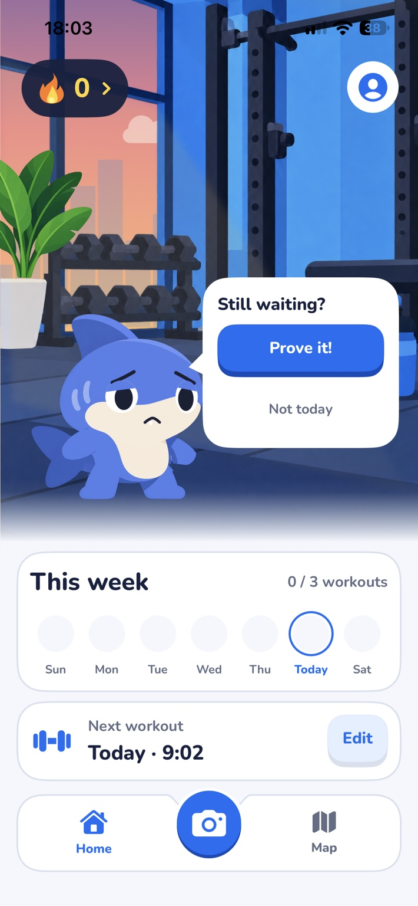
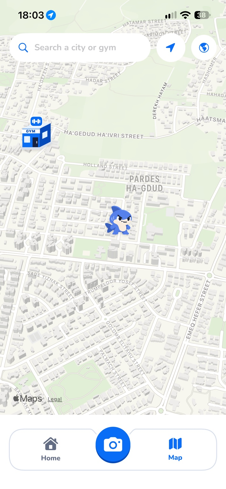
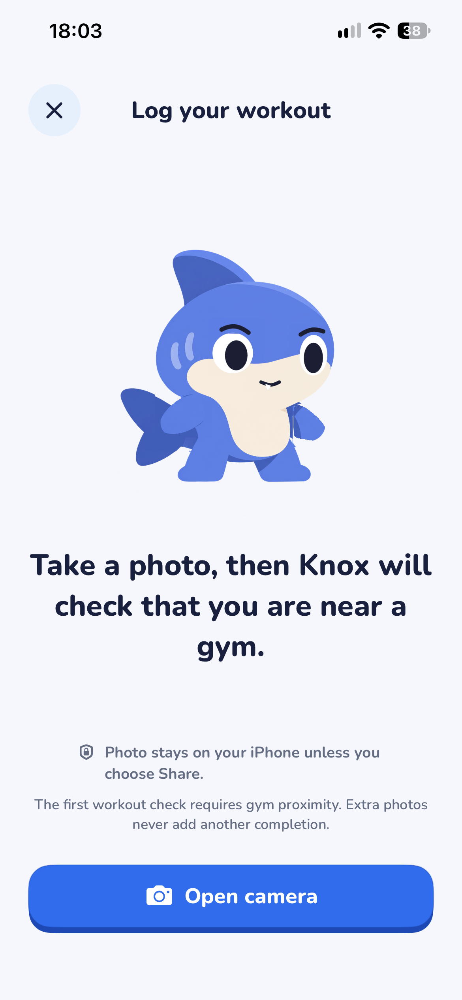
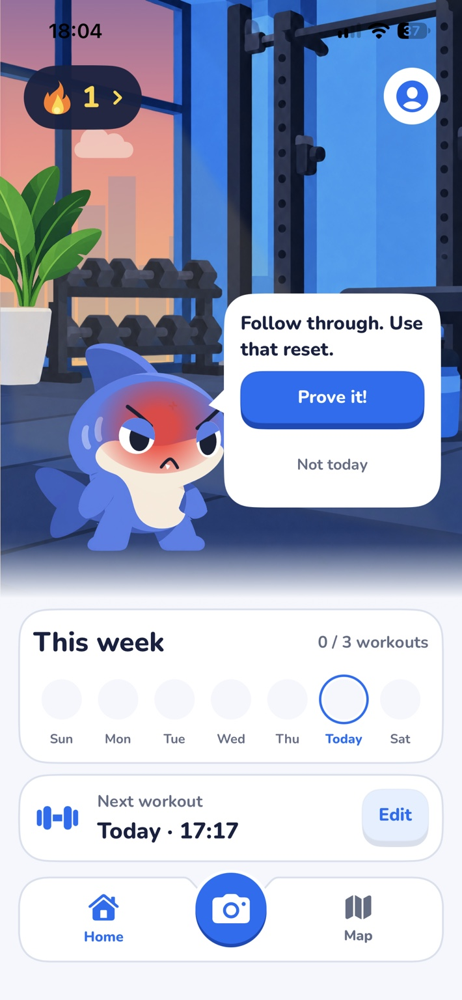

<h1 align="center">GymPal</h1>

  <strong>A workout promise with a personality.</strong>

  <strong>Harel Meltser · iOS engineering &amp; product</strong> 
  SwiftUI · WidgetKit · MapKit · In active development

GymPal is an iPhone-first workout accountability companion. You make a plan, and a character-driven coach keeps that commitment visible through the app and iPhone widgets. The focus is on actually showing up, not counting sets and reps.

<table>
  <tr>
    <th align="center">A coach that reacts</th>
    <th align="center">Discover nearby gyms</th>
  </tr>
  <tr>
    <td align="center"></td>
    <td align="center"></td>
  </tr>
  <tr>
    <td align="center">Character-led reminders and weekly commitments.</td>
    <td align="center">A native map with custom gym and mascot markers.</td>
  </tr>
  <tr>
    <th align="center">Photo &amp; location check-in</th>
    <th align="center">Expressive accountability</th>
  </tr>
  <tr>
    <td align="center"></td>
    <td align="center"></td>
  </tr>
  <tr>
    <td align="center">A lightweight check-in flow, with the photo private by default.</td>
    <td align="center">Mood and dialogue change with the commitment state.</td>
  </tr>
</table>

Actual captures from an evolving development build, not polished concept mockups. Screens and behaviors may change before release.

## What I built

- **Native iPhone experience.** Built much of the SwiftUI interface, including the mascot-led dashboard, custom controls, and animated character states that make accountability feel personal.
- **Maps and gym discovery.** Implemented the Apple Maps-based gym surface with custom markers, map navigation, and the location-aware check-in experience.
- **Accountability interactions.** Worked on the transitions between planned workouts, reminders, check-ins, and character reactions so the UI reflects what the user actually committed to.
- **App and widget integration.** Worked across the app's widget-centered experience, using shared local accountability state so the character's prompt can stay consistent across surfaces.

## The engineering idea

The hard part is keeping a workout promise consistent across the main app, a Home Screen widget, and a Lock Screen experience, even when the network is slow. GymPal's architecture is **local-first**: App Intents update shared App Group state for immediate feedback, while persistence and queued operations support later synchronization with Supabase.

The map and camera flow add context to a check-in. A nearby-gym location check is an accountability signal, **not proof that a workout took place**. Photos stay on the iPhone unless the user chooses to share them.

**Built with:** Swift · SwiftUI · WidgetKit · App Intents · MapKit · Supabase

## Collaboration

I build GymPal with [Ilay Gibor](https://github.com/ilaygibor). My work has centered on native implementation, the visual and animation system, maps, and check-in flows. Ilay has contributed onboarding, schedule setup, dashboard interactions, workout notes, tests, and product decisions. We collaborate on the overall experience.

GymPal is **in development**, and this page is a public product and engineering showcase. The production source repository remains private.
