<h1 align="center">GymPal</h1>

<strong>A workout promise with a personality.</strong>

<strong>Harel Meltser · iOS engineering &amp; product</strong> SwiftUI · WidgetKit · ActivityKit · MapKit · In active development

GymPal is an iPhone workout-accountability companion. Make a realistic plan, choose your buddy, and explicitly log the training you complete. Knox is a composed shark coach, Milo a supportive red panda, and Rex a chaotic crocodile. Their dialogue and expressive poses respond to the commitment state.

## The current interface

<table>
<tr><th>Home · nature</th><th>Profile</th></tr>
<tr><td>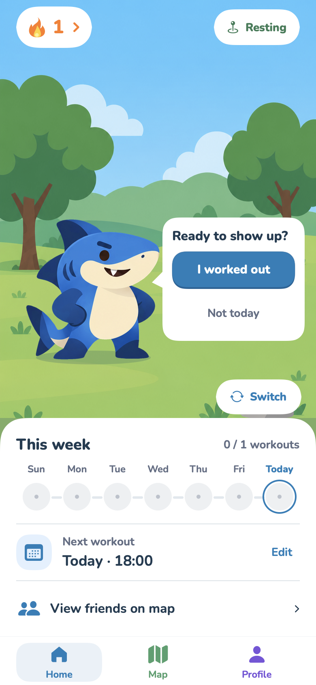</td><td>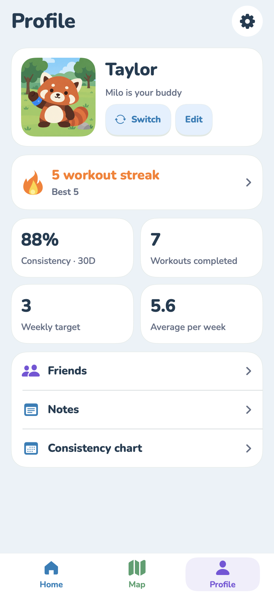</td></tr>
<tr><th>Plan your week</th><th>The promise starts the streak</th></tr>
<tr><td>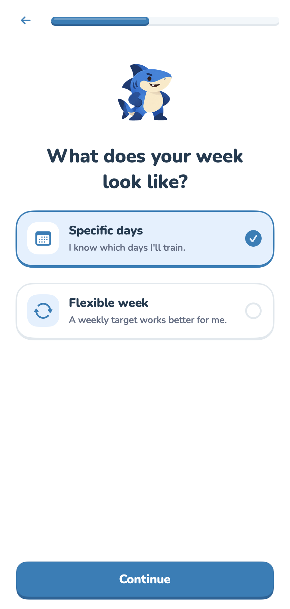</td><td>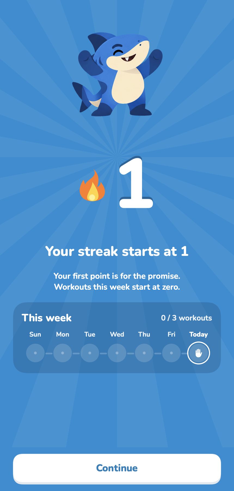</td></tr>
<tr><th>Check-in demo</th><th>Streak demo</th></tr>
<tr><td>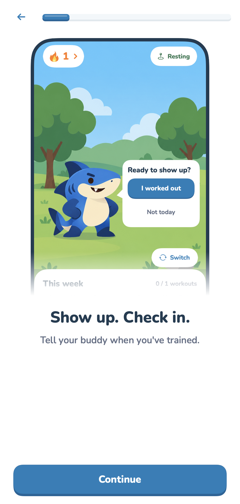</td><td>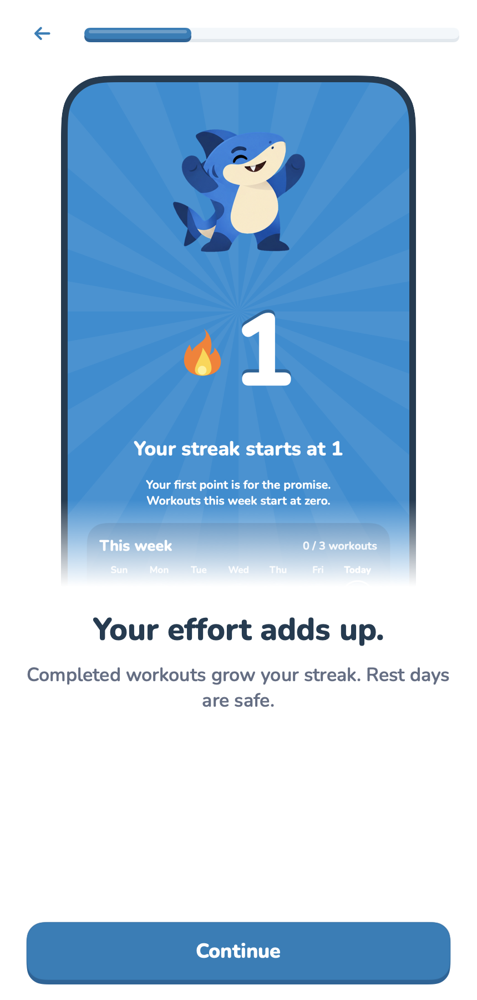</td></tr>
</table>

After the scripted introduction, setup has seven visible screens. Optional reminders sit with the time question; the promise celebration leads directly into real saving and Home. The loading state uses the selected buddy and a Home skeleton, with reduced motion support and no artificial delay.

Current loading layout
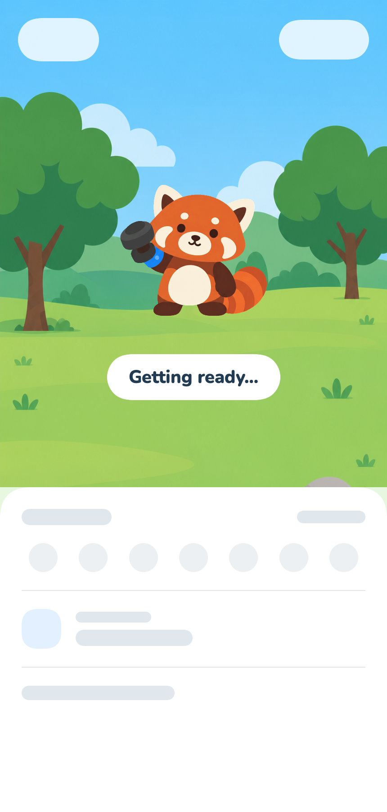

**Capture provenance:** the images above are fresh macOS captures of the production SwiftUI views with sample state. They are not iPhone screenshots or illustrated UI concepts. Mascots use the current still exports in this capture harness; still images do not demonstrate animation or device interaction.

### Widgets and Live Activity content

<table><tr><th>Knox</th><th>Milo</th><th>Rex</th></tr>
<tr><td>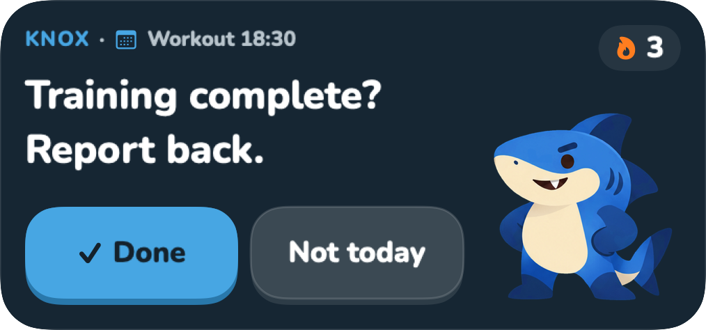</td><td>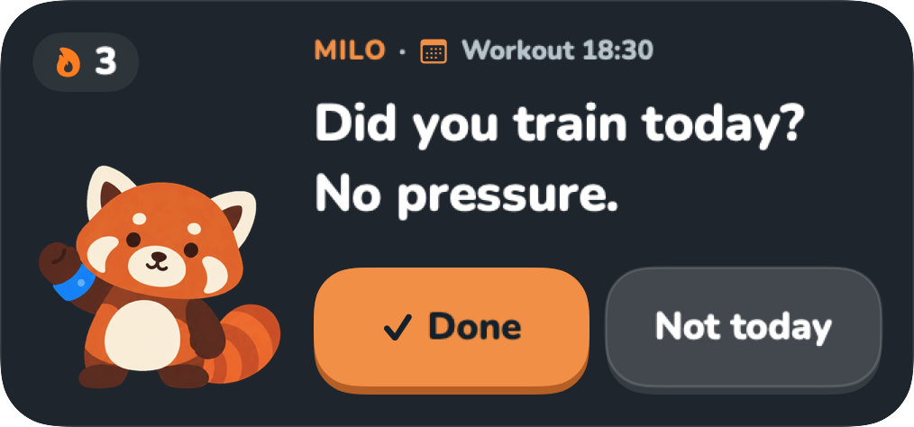</td><td>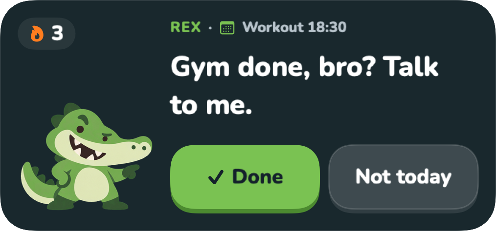</td></tr>
<tr><td>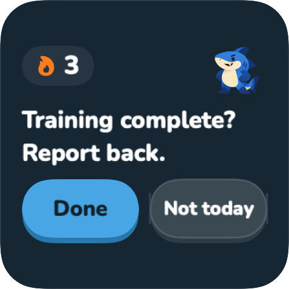</td><td colspan="2">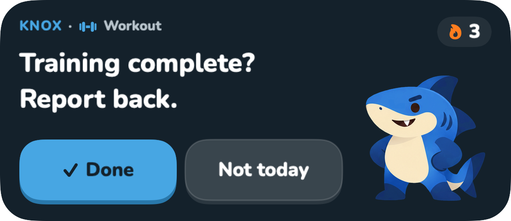</td></tr></table>

These are native component captures with sample data. The Live Activity image shows its SwiftUI content, not a live iPhone Lock Screen. iOS controls tinted/clear rendering and the actual system presentation.

## What I built

- **Native interface and character system.** A continuous companion scene, grounded expressive poses, dialogue actions, a unified Home panel, consistent Nunito typography and white navigation. The nature scene changes to the gym interior on a fresh, confident gym match.
- **Workout accountability.** Explicit completion works independently of location. Shared account, date and idempotency checks prevent stale or duplicate awards; at most one workout is awarded per local day. The onboarding promise starts the streak at one without inventing a workout.
- **Map and friends.** Native, always-light Apple Maps with gym discovery, place details and Apple Maps directions. Optional one-hour gym sharing is limited to accepted friends and expires; precise location is not shared.
- **App, widgets and Live Activities.** Shared local App Group state and App Intents keep workout actions consistent across surfaces. Small/medium widgets and compact Live Activity content use the same character identities and contextual dialogue.

## The engineering idea

GymPal is **local-first**. App Intents update shared accountability state, while queued operations support later synchronization with Supabase. Completion is a deliberate user action: gym arrival and scenery never award a workout. Photo check-ins have been removed from this version. Account linking remains optional in Settings.

**Built with:** Swift · SwiftUI · Rive · WidgetKit · ActivityKit · App Intents · MapKit · Supabase

## Collaboration

I build GymPal with [Ilay Gibor](https://github.com/ilaygibor). My work has centered on native implementation, the visual and animation system, maps, and accountability interactions. Ilay has contributed onboarding, schedule setup, dashboard interactions, workout notes, tests, and product decisions. We collaborate on the overall experience.

GymPal is **in development**. This public showcase contains images and product/engineering notes only; production source remains private. Device accessibility, motion and system-widget behaviour require physical-iPhone verification separately from these component captures.
